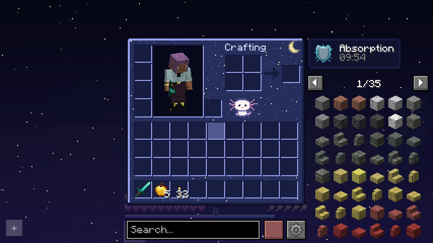
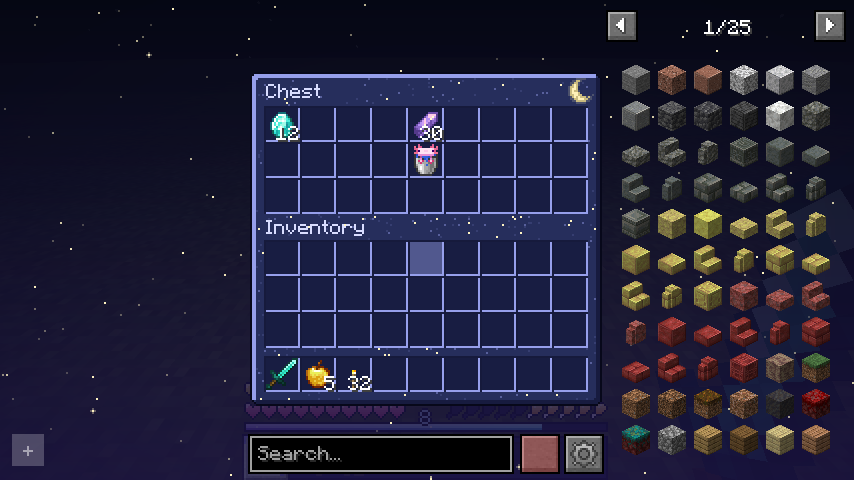
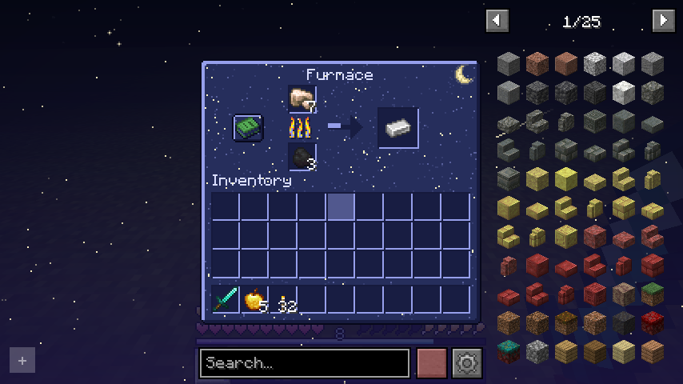
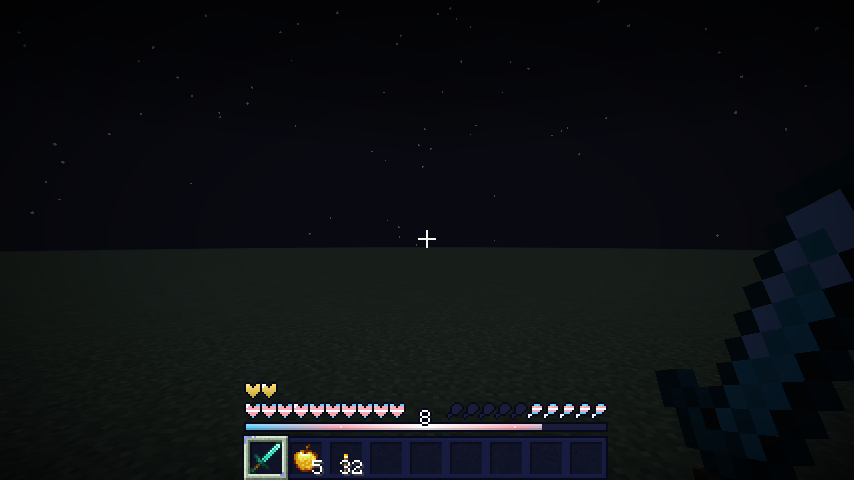
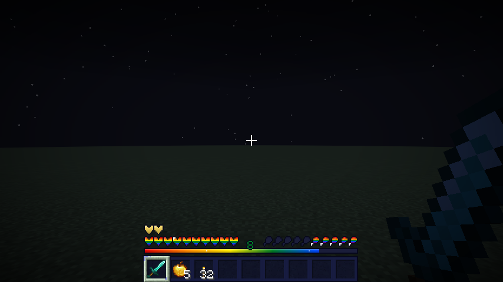
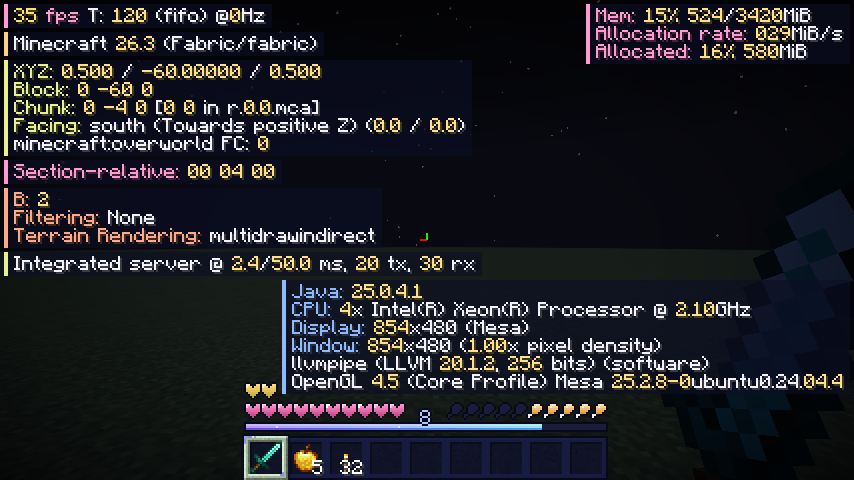
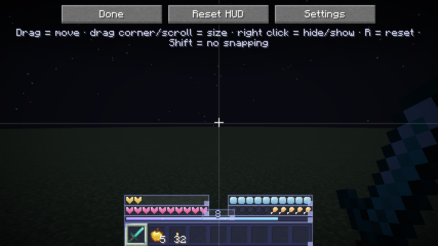
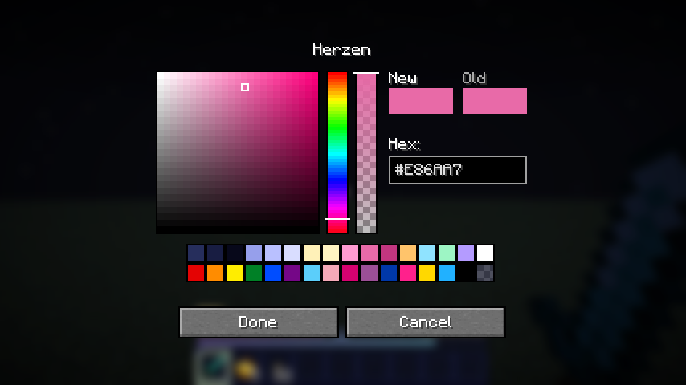

# Lu Hub 🌙

Fabric-Mod für **Minecraft 26.3**: Nachthimmel-Theme für HUD, Inventar und alle Container,
eine frei verschiebbare und farbig markierte F3-Ansicht, Pride-Varianten für die Statusleisten
und **Axo**, das Maskottchen, als animierter Rezeptbuch-Knopf im Inventar.

| Inventar mit Axo | Truhe | Ofen |
|---|---|---|
|  |  |  |

| HUD (Trans) | HUD (Regenbogen) | F3-Ansicht |
|---|---|---|
|  |  |  |

| HUD-Editor | Farbwähler |
|---|---|
|  |  |

*(Screenshots aus dem automatischen Spieltest, mit REI installiert.)*

## Installation

1. [Fabric Loader](https://fabricmc.net/use/) ≥ 0.19.5 für Minecraft 26.3 installieren
2. [Fabric API](https://modrinth.com/mod/fabric-api) für 26.3 in den `mods`-Ordner legen
3. `luhub-<version>.jar` in den `mods`-Ordner legen
4. Optional: [REI](https://modrinth.com/mod/rei) und [Mod Menu](https://modrinth.com/mod/modmenu) – Lu Hub funktioniert mit beiden

Java 25 wird benötigt (bringt der Minecraft-Launcher mit).

## Tasten

| Taste | Funktion |
|---|---|
| `U` | Lu-Hub-Einstellungen |
| `H` | HUD-Editor (Drag & Drop) |
| `F3` | F3-Ansicht (die Taste lässt sich in den Lu-Hub-Einstellungen → F3 umbelegen) |
| – | F3-Editor und zusätzliche F3-Taste (frei belegbar unter *Optionen → Steuerung → Lu Hub*) |

Außerdem: Klick auf den **Mond** oben rechts in jedem Inventar/Container öffnet die Einstellungen.

## Features

### HUD (Herzen, Hunger, Luft, XP, Rüstung, Inventarleiste)
- **HUD-Editor** (`H`): jedes Element per Drag & Drop verschieben, an der **Ecke größer/kleiner ziehen**
  oder mit dem Mausrad skalieren, Rechtsklick blendet aus/ein, `R` setzt zurück, Pfeiltasten verschieben pixelgenau,
  Elemente rasten an Bildschirmrand und Mitte ein (Shift = ohne Einrasten)
- Stile für Herzen, Hunger, Luftblasen, XP-Leiste und XP-Level:
  *Nachthimmel*, *Eigene Farben*, *Vanilla* und Pride-Flaggen:
  Regenbogen, Progress, Trans, Bi, Pan, Lesbisch, Schwul (MLM), Nichtbinär, Asexuell, Aromantisch,
  Genderfluid, Agender, Polysexuell, Demigirl, Demiboy
- Gift, Wither, Frost, Absorption und Hunger-Effekt werden weiterhin farblich angezeigt,
  Wackeln bei wenig Leben, Regenerations-Welle und Hardcore-Herzen bleiben erhalten
- Füll-, Leer- und Umrissfarbe frei wählbar (Farbwähler mit Farbfeld, Deckkraft, Hex-Eingabe und Vorlagen)

### F3-Ansicht
- Jeder F3-Eintrag (FPS, Position, Biom, Licht, Speicher, Block im Blick …) wird ein eigenes **Panel**
  mit eigener Akzentfarbe
- **Farbige Markierung**: Bezeichnungen in Panel-Farbe, Zahlen hervorgehoben, Überschriften extra,
  FPS als Ampel (grün/gelb/rot)
- **F3-Editor**: Panels per Drag & Drop verschieben, an der Ecke skalieren, Rechtsklick blendet aus,
  `C` ändert die Farbe eines Panels
- Die **F3-Taste ist umbelegbar** (Einstellungen → F3 → „F3-Taste“), zusätzlich gibt es eine freie Zweittaste
- Welche Einträge angezeigt werden, regelt weiterhin das Vanilla-Menü (F3 + F6), Mod-Einträge funktionieren automatisch

### Nachthimmel-Theme für Inventar, Kisten, Öfen & Co.
- Alle Vanilla-Container (Inventar, Truhen, Öfen, Werkbank, Amboss, Braustand, Kreativ-Inventar …),
  die Inventarleiste und das Rezeptbuch werden beim Laden in Nachtblau mit Sternen umgefärbt –
  farbige Teile wie Feuer oder Pfeile bleiben erhalten
- Funkelnder Sternenhimmel mit Sternschnuppen hinter geöffneten Inventaren, Mond oben rechts
- Alle Farben (Hintergrund, Slots, Kanten, Sterne, Überschriften, Mond, Himmel) einstellbar,
  optional auch für Container anderer Mods
- Weil die Texturen aus den aktuell geladenen Originalen erzeugt werden, funktionieren Resource-Packs darunter weiter

### Axo
- Axo ersetzt das grüne Rezeptbuch im Inventar – der Knopf öffnet das Rezeptbuch weiterhin
- Animation: wackelnde Kiemen, Blinzeln, leichtes Schweben; beim Drüberfahren hüpft Axo,
  wedelt mit dem Schwanz und es steigen Herzchen auf
- Wenn REI das Rezeptbuch ausblendet, bleibt Axo trotzdem an seinem Platz
- Das Sprite-Sheet (`assets/luhub/textures/gui/axo.png`) wird von `tools/axo_sprite.py` erzeugt
  und kann per Resource-Pack ersetzt werden

### REI
Lu Hub ändert nur Vanilla-Texturen, Überschriften-Farben und den Hintergrund hinter Containern –
das REI-Overlay, die REI-Suche und REI-Rezeptansichten bleiben unberührt. Lu-Hub-Tasten werden nur im Spiel
(ohne offenes Menü) ausgewertet und stören die REI-Suche daher nicht.

## Konfiguration

Alles wird in `config/luhub.json` gespeichert und lässt sich im Spiel einstellen
(Taste `U`, Mond-Klick oder Mod Menu).

## Bauen

```bash
./gradlew build            # Jar landet in build/libs/
./gradlew runClient        # Spiel mit dem Mod starten
./gradlew runClientGameTest  # automatischer Test mit Screenshots (run/screenshots)
python3 tools/axo_sprite.py  # Axo-Sprite-Sheet und Mod-Icon neu erzeugen (benötigt Pillow)
```

Benötigt JDK 25.
